


 

### Talk to the people who shaped you, in their own words.

Every answer is built from what they really said or wrote and cites where it came from. 
When the archive has nothing on a question, CHRONUS says **“I don't know”** instead of making something up.

[**See it**](#see-it-in-action) · [**How it works**](#how-an-answer-is-made) · [**Features**](#what-you-can-do) · [**Responsible by design**](#responsible-by-design) · [**Under the hood**](#under-the-hood) · [**Design notes**](docs/DESIGN.md)

> [!NOTE]
> **This repository is a showcase.** CHRONUS's source code is private. This page explains what it does
> and how it's built. If you'd like a walkthrough or a look at the code (for example, as part of a job
> application), reach out through my GitHub profile: [**@manavaghera**](https://github.com/manavaghera).

## What is CHRONUS?

CHRONUS is a consent-first memory archive you can have a conversation with. Give it a person's
interviews, letters, journals, voice notes or chats, and it answers as them, quoting their own words,
showing every source, and staying honest about what it doesn't know.

It comes with **Elon Musk** (public interviews, about 10,000 tweets, two biographies) and **seven
public-domain figures**: Einstein, Marie Curie, Nikola Tesla, Gandhi, Lincoln, Marcus Aurelius and
Shakespeare. Families can build private models of people in their own lives, with consent, and share
them with each other.



## See it in action

  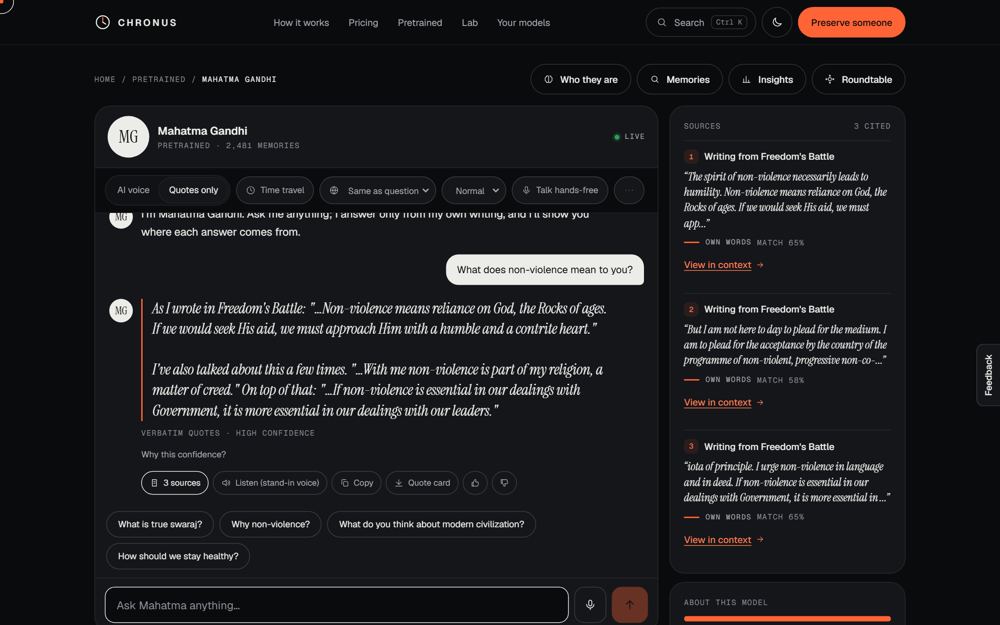
   A real answer: word-for-word quotes, high confidence, and every source one click away.

<table>
<tr>
<td width="50%">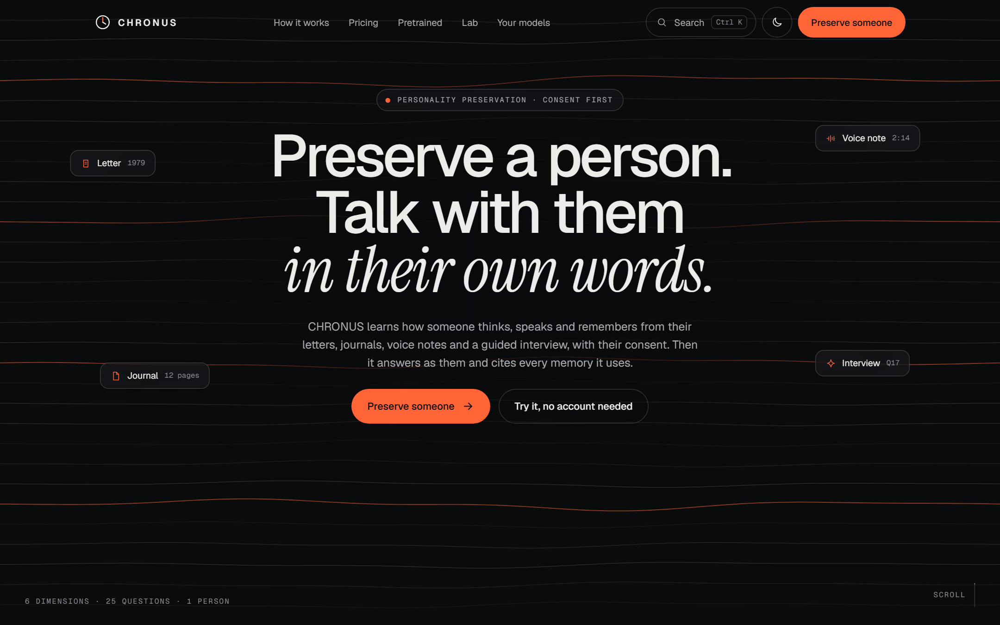 The home page</td>
<td width="50%">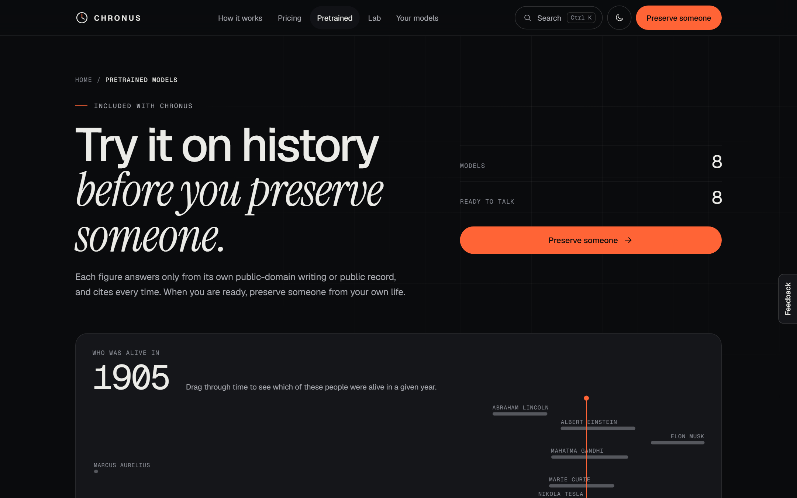 Eight ready-made models, with a “who was alive in…” timeline</td>
</tr>
<tr>
<td>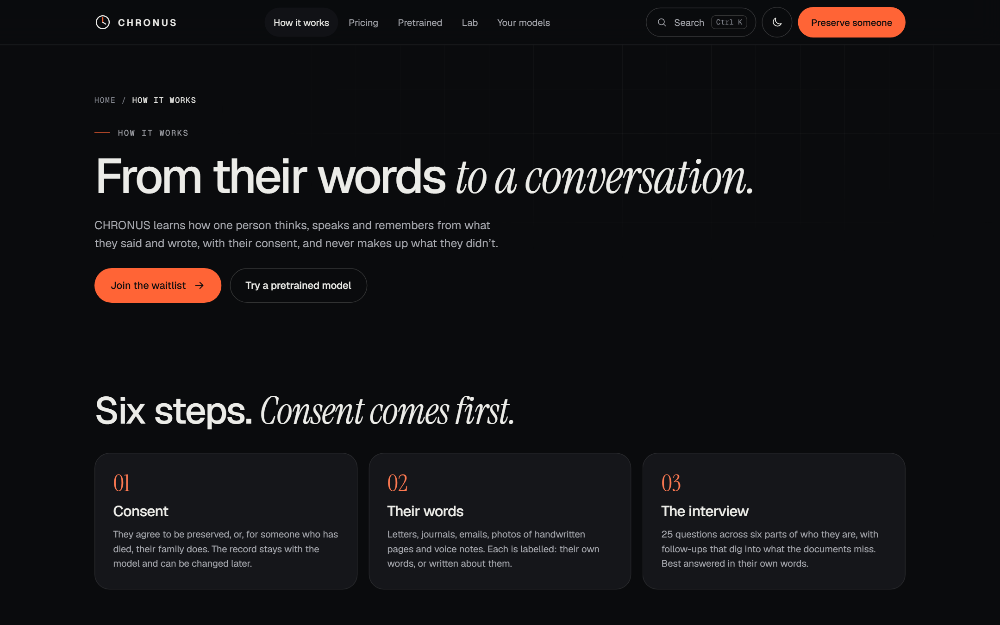 How it works: consent comes first</td>
<td>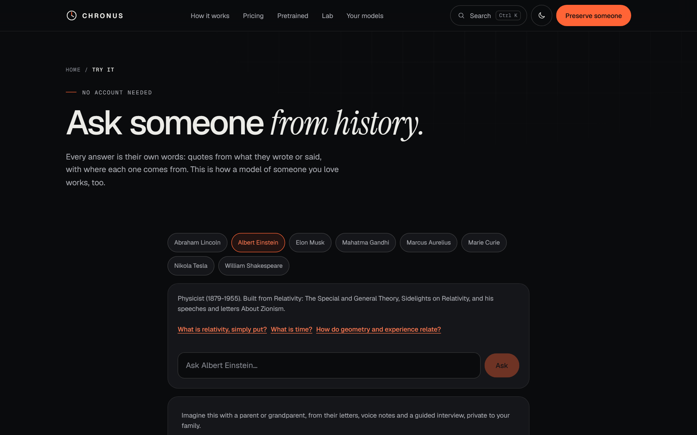 Try it without an account</td>
</tr>
</table>

<b>On a phone</b>

 

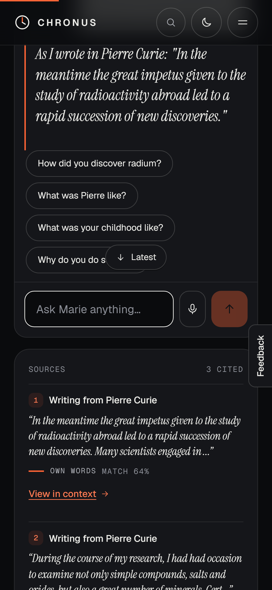

## How an answer is made

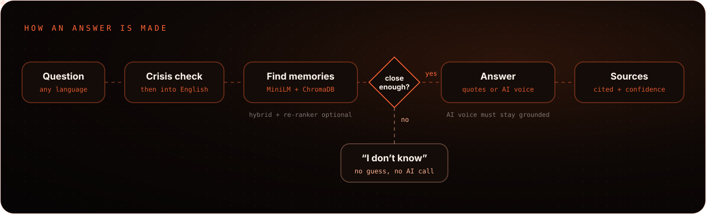

1. **Crisis check first.** Crisis language makes the model step out of character and show helplines.
2. **Any language in.** Hindi and Gujarati (even typed in English letters) are understood, and the answer comes back in the same language.
3. **Find the memories.** Semantic search over everything the person said or wrote, with optional keyword search and re-ranking.
4. **Close enough?** Each model has its own calibrated threshold. Below it, the answer is “I don't know”, and no AI is called at all.
5. **Answer.** *Quotes only* uses their exact sentences. The *AI voice* rewrites their words with citations, and falls back to quotes if it isn't grounded in the evidence.
6. **Show the work.** Sources, a confidence that explains itself, and “view in context” for every quote.

## What you can do

<table>
<tr>
<td width="33%" valign="top"><h4>💬 Cited answers</h4>Every reply links to its sources, with “view in context” and a confidence that says why.</td>
<td width="33%" valign="top"><h4>🎚️ Quotes or AI voice</h4>Word-for-word quotes, or an AI voice that rewrites their words and falls back to quotes if it drifts.</td>
<td width="33%" valign="top"><h4>🕰️ Time travel</h4>Answer only from memories dated within the years you choose.</td>
</tr>
<tr>
<td valign="top"><h4>🌏 Hindi · Gujarati · Hinglish</h4>Ask in your language, even typed in English letters.</td>
<td valign="top"><h4>🎙️ Voice and calls</h4>Dictate, listen, or go hands-free on the call screen.</td>
<td valign="top"><h4>🎭 Roundtable</h4>Ask 2–4 models the same question and let them reply to each other.</td>
</tr>
<tr>
<td valign="top"><h4>🧬 Build a model</h4>Consent, then letters, journals, PDFs, voice notes, WhatsApp or email exports, and a 25-question interview with follow-ups.</td>
<td valign="top"><h4>📅 A question a day</h4>A gentle prompt, in the app or by email, that grows the archive one answer at a time.</td>
<td valign="top"><h4>⏳ Time capsules</h4>Write a message today; it's delivered on the date you pick.</td>
</tr>
<tr>
<td valign="top"><h4>📖 Life-story book</h4>Turn a model's memories into a book you can print or save as a PDF.</td>
<td valign="top"><h4>👪 Family sharing</h4>Viewer, contributor and owner roles, with one-time invite links.</td>
<td valign="top"><h4>📲 Installable app</h4>Add it to your phone's home screen. Nothing private is cached on the device.</td>
</tr>
<tr>
<td valign="top"><h4>📊 Insights</h4>What people asked, what the archive couldn't answer, and the interview question that would fill the gap.</td>
<td valign="top"><h4>🔐 Encrypted export</h4>Save a model as a password-protected file and import it on another CHRONUS install.</td>
<td valign="top"><h4>🚪 Try it first</h4>Anyone can talk to the public figures without an account.</td>
</tr>
</table>

## Responsible by design

> [!IMPORTANT]
> A model of a real person is a serious thing. CHRONUS is built so it can't quietly put words in anyone's mouth.

- **Consent before anything.** A model of a living person needs their consent. Memorial mode covers someone who has died.
- **Spoken voice consent.** Before a voice is cloned, the person reads a one-time code aloud. CHRONUS checks the words and that it's the same speaker as the sample, on its own server, before anything goes to the voice service.
- **Never a fake quote.** Every memory is labelled as their **own words**, **written by others** or **synthesized**. Someone else's text is never presented as their quote.
- **Honest limits.** Below each model's threshold it says “I don't know” without calling an AI.
- **Stand-in voices for public figures.** Clearly labelled, never a clone.
- **Wellbeing.** Crisis language steps out of character and shows helplines. Long sessions get a break reminder.
- **Family roles and a legacy contact.** Sharing is deny-by-default. Owners choose who keeps, freezes or deletes a model after they die.
- **Your data is yours.** Download everything, delete your account, and “delete” really deletes. Privacy requests follow India's DPDP Act.

## Under the hood

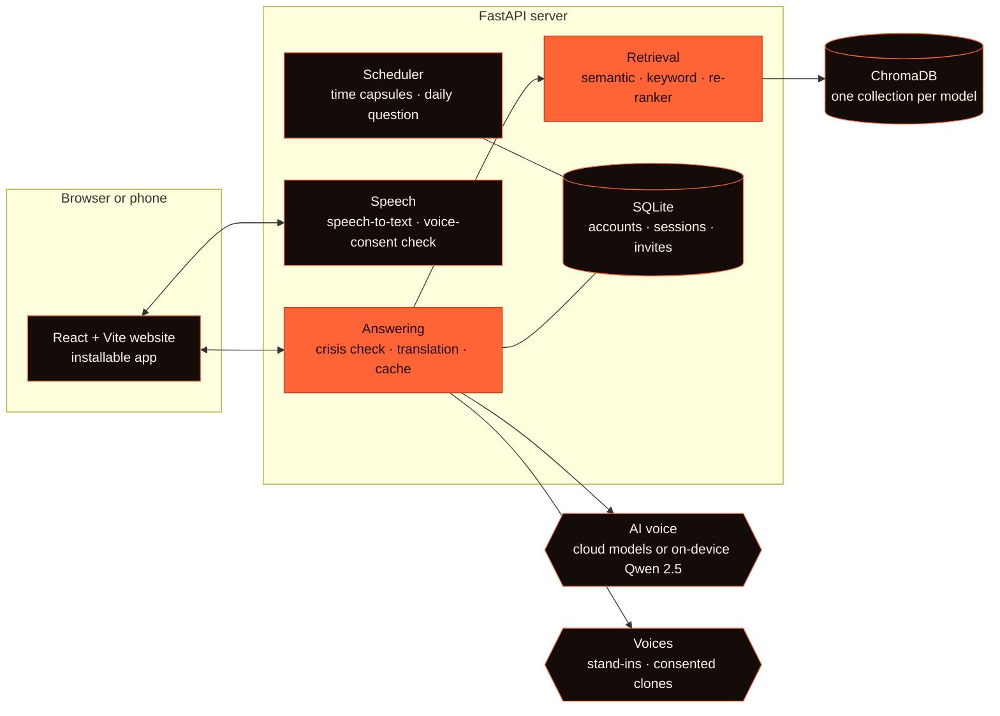

| Layer | Built with |
|---|---|
| Website and app | React 18, Vite, an installable web app, English · Hindi · Gujarati |
| Server | Python 3.12, FastAPI, SQLite |
| Memory search | Sentence-BERT (MiniLM), ChromaDB, BM25, a cross-encoder re-ranker |
| AI voice | OpenRouter, OpenAI or Ollama, or on-device Qwen 2.5 7B (4-bit) with LoRA style adapters |
| Speech and voice | faster-whisper, a speaker-verification model (ONNX), Kokoro, Fish Audio |
| Quality and operations | pytest, Vitest, Playwright, GitHub Actions, pip-audit, Docker, Caddy, Sentry |

**Quality:** 584 automated tests, a 115-question release check on real questions, a load test, and
CI that blocks on failing tests and known-vulnerable dependencies.

**Want the details?** [**docs/DESIGN.md**](docs/DESIGN.md) walks through the hard problems: never
inventing a quote, calibrating “I don't know”, verifying spoken consent, family roles, and an honest
experiment in learning someone's speaking style.

## Built by

<table>
<tr>
<td></td>
<td><b>Manav Aghera</b> Computer Science &amp; Engineering, Parul University, Vadodara <a href="https://github.com/manavaghera">github.com/manavaghera</a></td>
</tr>
</table>

© 2026 Manav Aghera. All rights reserved. This repository is for viewing only; see <a href="LICENSE">LICENSE</a>. 
Built for the voices we don't want to lose.

